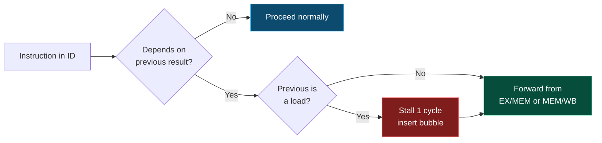

<div align="center">


<a href="https://github.com/Prathameshgirhe/repo-name">
  
</a>

<br/>


**[Architecture](#-pipeline-architecture) · [Hazards](#-hazard-handling) · [Verification](#-verification-flow) · [Results](#-results) · [Run It](#-getting-started)**

</div>


## 🚀 Overview

A **32-bit, 5-stage pipelined RISC-V (RV32I) processor** written in **Verilog RTL**. It handles **data hazards with a forwarding unit** and **load-use hazards with a hazard detection unit**, and has been verified in simulation and synthesized with Xilinx Vivado.

| 🎯 Feature | 📋 Detail |
|---|---|
| **ISA** | RISC-V RV32I (32-bit base integer) |
| **Pipeline** | IF → ID → EX → MEM → WB |
| **Hazard control** | Forwarding unit (EX/MEM, MEM/WB) + load-use stall |
| **Verification** | 20+ directed instruction sequences, 100+ simulation scenarios |
| **Tools** | Verilog HDL, QuestaSim / Vivado Simulator, Xilinx Vivado |
| **Result** | ~28% fewer pipeline stalls vs. no-forwarding baseline |


## 🧠 Pipeline Architecture

<div align="center">
  
</div>

<br/>

| Stage | Name | What happens |
|:---:|---|---|
| 🟦 **IF** | Instruction Fetch | PC addresses instruction memory; PC + 4 computed |
| 🟪 **ID** | Decode / Reg Fetch | Control decode, register read, immediate generation, hazard check |
| 🟥 **EX** | Execute | ALU operation, forwarding MUXes pick the freshest operand, branch compare |
| 🟨 **MEM** | Memory Access | Loads and stores access data memory |
| 🟩 **WB** | Write Back | Result is written back to the register file |

<details>
<summary><b>🔍 Click to see the pipeline registers</b></summary>

| Register | Carries |
|---|---|
| `IF/ID` | instruction, PC |
| `ID/EX` | rs1 / rs2 data, immediate, rd, rs1, rs2, control signals |
| `EX/MEM` | ALU result, store data, rd, control signals |
| `MEM/WB` | memory data, ALU result, rd, control signals |

</details>


## ⚡ Hazard Handling

### 1️⃣ Data forwarding (bypassing)

When a result is needed before it is written back, the forwarding unit routes it straight into the ALU inputs.

<div align="center">
  
</div>

### 2️⃣ Load-use hazard (stall)

A load's data is only ready after MEM, so one dependent instruction must wait one cycle. The hazard unit freezes the PC and `IF/ID`, inserts a bubble into `ID/EX`, and forwarding handles the rest.

<div align="center">
  
</div>



<details>
<summary><b>📐 Hazard / forwarding equations</b></summary>

```verilog
// Forwarding for operand A (same idea for B with rs2)
if (EX_MEM_RegWrite && EX_MEM_rd != 0 && EX_MEM_rd == ID_EX_rs1)
    ForwardA = 2'b10;            // from EX/MEM
else if (MEM_WB_RegWrite && MEM_WB_rd != 0 && MEM_WB_rd == ID_EX_rs1)
    ForwardA = 2'b01;            // from MEM/WB
else
    ForwardA = 2'b00;            // from register file

// Load-use hazard detection
if (ID_EX_MemRead && (ID_EX_rd == IF_ID_rs1 || ID_EX_rd == IF_ID_rs2))
    stall = 1;                   // freeze PC + IF/ID, bubble into ID/EX
```

</details>


## 🧪 Verification Flow

<div align="center">
  
</div>

- ✅ **20+ directed instruction sequences** (ALU, load/store, branches, back-to-back dependencies)
- ✅ **100+ simulation scenarios** in QuestaSim / Vivado Simulator
- ✅ Waveform inspection of forwarding paths and stall/bubble behavior


## 📊 Results

<div align="center">
  
</div>

> 📝 **Note:** Numbers above are target ranges. Update them with your final measured values from the simulation logs and the Vivado utilization / timing reports.


## 📁 Repository Structure

```text
.
├── rtl/
│   ├── top.v                 # Top-level pipelined core
│   ├── pc.v
│   ├── instr_mem.v
│   ├── reg_file.v
│   ├── imm_gen.v
│   ├── control_unit.v
│   ├── alu.v
│   ├── alu_control.v
│   ├── forwarding_unit.v     # EX/MEM and MEM/WB bypass
│   ├── hazard_unit.v         # Load-use stall and flush
│   ├── data_mem.v
│   └── pipeline_regs.v       # IF/ID, ID/EX, EX/MEM, MEM/WB
├── tb/
│   ├── tb_top.v
│   └── programs/             # Directed .hex / .mem test programs
├── scripts/
│   ├── run_sim.do            # QuestaSim script
│   └── synth.tcl             # Vivado synthesis script
├── assets/                   # README images (SVG)
└── README.md
```

> Adjust the tree to match your actual file names.

## 🏁 Getting Started

```bash
# 1. Clone
git clone https://github.com/Prathameshgirhe/repo-name.git
cd repo-name
```

<details>
<summary><b>▶️ Simulate with QuestaSim</b></summary>

```bash
vlib work
vlog rtl/*.v tb/tb_top.v
vsim -c work.tb_top -do "run -all; quit"
```

</details>

<details>
<summary><b>▶️ Simulate with Icarus Verilog + GTKWave (free)</b></summary>

```bash
iverilog -o sim.out rtl/*.v tb/tb_top.v
vvp sim.out
gtkwave dump.vcd
```

</details>

<details>
<summary><b>🔧 Synthesize with Vivado</b></summary>

```bash
vivado -mode batch -source scripts/synth.tcl
```

Check `utilization.rpt` and `timing_summary.rpt` for LUTs, FFs, Fmax and WNS.

</details>

## 🗺️ Roadmap

- [x] 5-stage RV32I pipeline
- [x] Forwarding unit
- [x] Load-use hazard detection
- [x] Directed + regression testbenches
- [x] Vivado synthesis
- [ ] Branch prediction (static → 2-bit dynamic)
- [ ] Control hazard flush optimization
- [ ] M-extension (multiply/divide)
- [ ] Caches (I-cache / D-cache)
- [ ] FPGA board demo

## 🤝 Contributing

Issues and pull requests are welcome. Fork the repo, create a feature branch, and open a PR.

## 👤 Author

**Prathamesh Girhe**  ·  [GitHub](https://github.com/Prathameshgirhe)

<div align="center">


⭐ **If this project helped you, drop a star!** ⭐

</div>
